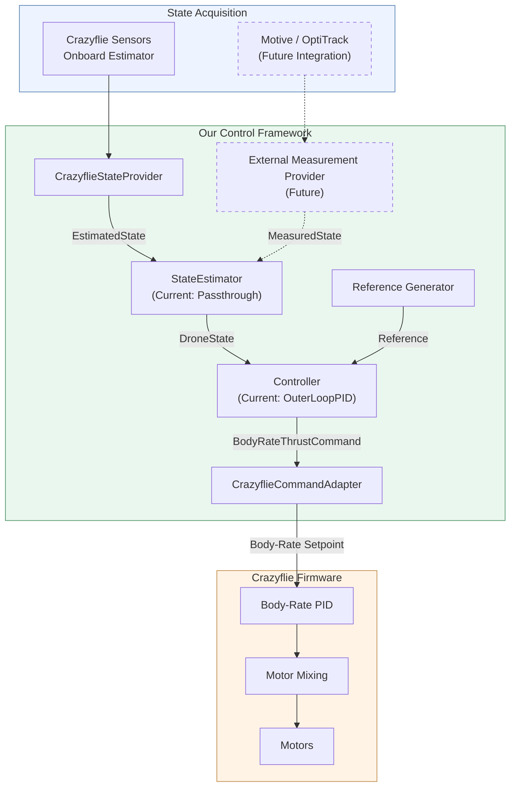

# Software Architecture

## 1. Purpose and Design Boundaries

The Drone Control Framework separates reference generation, reusable control
algorithms, state acquisition and estimation, hardware-specific command
conversion, timing and execution, and experiment-specific validation logic.

The current implementation is centered on `OuterLoopPIDController`. Other
controller families can implement the common interface in the future, but LQR,
MPC, and DeePC are not active controller implementations. Historical code under
`legacy/` is not part of the active dependency graph.

## 2. Control Architecture



The PC-side controller computes desired body-frame angular rates and collective
thrust. It does not compute individual motor commands or close the inner
body-rate loop. `CrazyflieCommandAdapter` owns hardware conversion and
transmission. With `rate=True`, the firmware closes the body-rate stabilization
loop and performs motor mixing.

## 3. Repository Responsibilities

```text
velocity_control_framework/
├── interfaces/     shared state, reference, command, and protocol definitions
├── controllers/    reusable control laws
├── estimators/     StateEstimator implementations
├── references/     reusable reference generators
├── backends/       state acquisition and command transmission
├── runner/         reusable timing and lifecycle coordination
├── logger/         logging package
└── tests/          automated framework and experiment tests
```

`experiments/` assembles these components and may contain validation-specific
logic. `tools/` contains diagnostics outside the normal control path. `legacy/`
preserves historical implementations. Detailed documentation is under `doc/`.

## 4. Shared Interfaces

### State types and estimator boundary

```text
Crazyflie estimator/logging -> EstimatedState --\
                                                   -> StateEstimator -> DroneState
Direct/external source      -> MeasuredState -----/
```

`EstimatedState` is a complete source-specific estimated state. `MeasuredState`
represents optional direct or external measurements, so every field may be
`None`. Both use world-frame position and velocity in SI units, Euler attitude
angles in radians, body rates in radians per second, and seconds for timestamps.

`StateEstimator.estimate(estimated_state, measured_state)` produces the unified
`DroneState` consumed by controllers. `DroneState` contains:

```text
position       world-frame [x, y, z], m
velocity       world-frame [vx, vy, vz], m/s
roll/pitch/yaw Euler attitude angles, rad
p/q/r          angular rates about body x/y/z, rad/s
timestamp      s
```

The active `PassthroughStateEstimator` copies all fields from `EstimatedState`
and intentionally ignores `MeasuredState`. It is an interface bridge, not a
sensor-fusion algorithm.

### StateProvider

`StateProvider` owns `start()`, `get_state()`, and `stop()`.
`CrazyflieStateProvider` configures three 10 ms log blocks for translation,
attitude, and body rates; combines the latest complete values; converts attitude
degrees to radians and body-rate milliradians per second to radians per second;
creates `EstimatedState`; supplies an empty `MeasuredState`; and invokes its
`StateEstimator`. It stores and returns thread-safe copies of the latest
`DroneState` and propagates logging errors.

### Reference

`Reference` contains desired world-frame position and velocity, desired yaw and
yaw rate, and a timestamp. Reusable generators live in `references/`;
experiments may generate stage-specific references. Reference generation
specifies desired motion and remains separate from controller mathematics.

### Controller and command

A `Controller` implements:

```text
DroneState + Reference + dt -> BodyRateThrustCommand
```

It also provides `reset()` for internal state. `BodyRateThrustCommand` carries
roll-, pitch-, and yaw-rate references in radians per second and normalized
collective thrust in `[0.0, 1.0]`. Its constructor rejects non-finite fields and
out-of-range thrust. Its `clipped()` helper returns a copy limited by positive
per-axis rate limits and validated thrust bounds; callers must invoke it
explicitly.

### CommandAdapter

`CommandAdapter` defines `send(command)` and `stop()`. The active
`CrazyflieCommandAdapter` converts rates from radians per second to degrees per
second, clamps normalized thrust to `[0, 1]`, converts it to `[0, 100]`, and
calls:

```text
send_setpoint_manual(roll_rate, pitch_rate, yaw_rate, thrust, rate=True)
```

`stop()` sends the Crazyflie stop setpoint. `PrintingCommandAdapter` supports
non-hardware inspection.

## 5. Runner and Experiment Architecture

There are two reusable execution paths.

`run_control_loop()` validates loop frequency and optional duration, starts
state acquisition, resets the controller, samples state and a callable reference
provider, calculates `dt` from a monotonic clock, updates the controller, sends
commands, and maintains a nominal period. In `finally`, it stops command output
and state acquisition.

`UniversalRunner` delegates reference/controller coordination to a
`FlightProgram`. Its lifecycle is:

1. Start the state provider and wait, with a configured timeout, for a
   pre-arming state.
2. Request arming, wait for the configured arming interval, and acquire a
   post-arming state immediately afterward.
3. Initialize the flight program with its selected initialization state and a
   monotonic start time. Stage 6 selects the post-arming state, verifies that it
   is newer, finite, and recent, and uses it to establish the fixed horizontal
   reference and landing altitude. Other validation stages retain their
   pre-arming initialization behavior.
4. At the configured control frequency, ask for the phase, acquire state,
   calculate `dt`, obtain `(Reference, command)`, transmit the command, and
   enqueue a standardized flight record and optionally invoke the legacy
   lower-frequency console/logging callback.
5. Drop missed deadlines instead of executing catch-up iterations.
6. Exit when the program reports completion or on interruption/error.
7. In `finally`, stop command output, request disarming if armed, stop state
   acquisition if started, and drain/finalize the run logger with a terminal
   status.

The runner does not select gains, create trajectories, or calculate commands.
`OuterLoopPIDValidationProgram` supplies those experiment-specific duties.
Asynchronous source telemetry and controller-step records are described in
[Flight logging](flight-logging.md).

## 6. Staged Validation Architecture

`experiments/outer_loop_pid_validation.py` defines these exact stages:

| Value | `ValidationStage` | Purpose encoded by the experiment |
|---:|---|---|
| 0 | `SOFTWARE_PIPELINE` | Zero-gain, zero-thrust command-pipeline check |
| 1 | `HORIZONTAL_POLARITY` | Small body-axis position offsets for mapping checks |
| 2 | `EQUILIBRIUM_THRUST` | Attitude-held thrust ramp and hold |
| 3 | `HORIZONTAL_STABILIZATION` | P-only horizontal feedback with equilibrium thrust |
| 4 | `HORIZONTAL_ALTITUDE` | Horizontal and altitude feedback |
| 5 | `HEADING` | Adds heading feedback, initially P-only |
| 6 | `FIXED_HOVER` | Smooth takeoff, fixed hover, and measured-state-qualified landing |
| 7 | `SLOW_TRAJECTORY` | Bounded, slow circular position reference |

Stages other than Stage 2 build an `OuterLoopPIDConfig` and invoke the generic
`OuterLoopPIDController`. Stage 6 wraps that output with experiment-specific
roll/pitch attitude feedback and final rate limiting. Stage 2 is deliberately
different: the experiment
program directly applies roll, pitch, and yaw attitude P feedback, rate limits,
and a thrust ramp. The `OuterLoopPIDController` instance created for Stage 2 has
inactive channels and is not used to generate the command. This Stage 2 law is
experiment-specific, not part of the reusable controller.

The experiment program owns initial-reference capture, polarity and trajectory
reference selection, stage duration/completion, and Stage 2 command generation.
The framework retains reusable state, command, backend, controller, and runner
components.

## 7. Implemented Safety Mechanisms

The code implements:

* finite-value and shape validation in public state, reference, command, and
  controller configuration types;
* normalized command-thrust validation and configurable controller thrust
  clamping;
* per-channel PID output saturation;
* `BodyRateThrustCommand.clipped()` for explicit downstream limiting;
* stage requirements for gains, mappings, limits, duration, and stage-specific
  fields;
* `physical_test_authorized=True` for physical Stages 1–7;
* Stage 1 caps of 0.05 m for offsets and 10 deg/s for horizontal rate;
* Stage 2 caps of 10 deg/s for attitude and heading rates, plus ordered and
  bounded thrust-ramp values;
* Stage 6 limits for tilt, tracking error, state age, control-loop delay, total
  flight duration, and final roll/pitch rate, plus altitude and vertical-speed
  conditions before normal completion;
* Stage 7 caps of 0.25 m radius and a minimum 10 s trajectory period;
* CLI/configuration stage matching before a physical run;
* first-state timeout and orderly stop, disarm request, and state shutdown.

These mechanisms reduce configuration and command risk; they do not prove the
vehicle is safe in every condition. The implementation does not show a general
geofence, independent watchdog, automatic state-bound abort, battery abort, or
collision avoidance, so this document does not claim those features. The
authorization flag records deliberate configuration intent; it is not a
substitute for a physical test procedure.

## 8. Implementation and Validation Status

The interfaces, passthrough estimator, Crazyflie backends, runner,
`OuterLoopPIDController`, and staged experiment are implemented. Automated tests
cover representative state and adapter conversions, PID transformations and
limits, estimator behavior, validation configuration, and Stage 2 equations and
timing.

The repository does not contain a durable hardware-results record establishing
stable hover, full staged completion, or trajectory-tracking performance.
Configured physical experiments and automated software tests must not be
described as successful flight validation. Hardware polarity, equilibrium
thrust, gains, and performance remain subject to controlled physical
verification and documentation.

## 9. Architectural Invariants

* Controllers do not call Crazyflie APIs or open hardware connections.
* Backends own hardware APIs, encodings, and unit conversion.
* Reference generators do not depend on a controller implementation.
* Controllers consume `DroneState`, not raw log variables.
* Framework angular rates use radians per second; adapters convert as needed.
* Different physical command levels use distinct types.
* Active framework code does not depend on `legacy/`.

See [`control-design.md`](control-design.md) for the implemented control laws and
[`../readme.md`](../readme.md) for the project overview.
