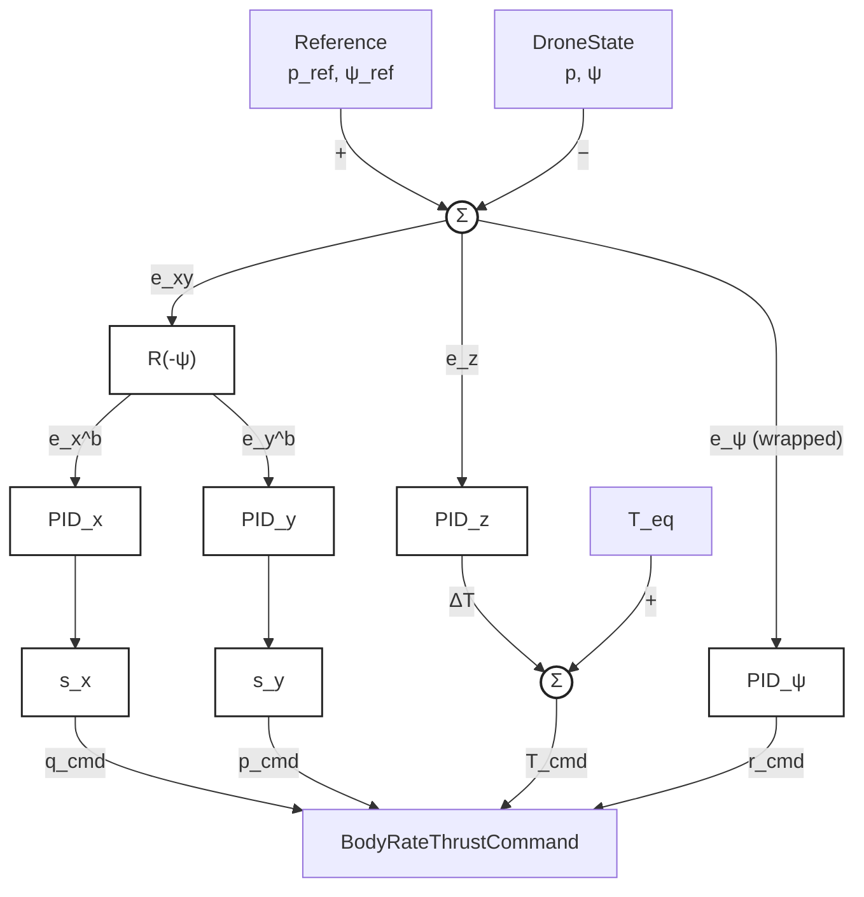

# Control Design

## 1. Control System Overview

### 1.1 Control Objectives and Scope

The framework supports interchangeable offboard controllers for Crazyflie
position and trajectory tracking. At the shared control boundary, an offboard
controller maps the current vehicle state and desired reference to commanded
body angular rates and normalized collective thrust. Crazyflie firmware closes
the onboard body-rate loops and performs motor mixing; the offboard command is
not a direct motor command.

`OuterLoopPIDController` is the currently implemented reusable controller. LQR,
MPC, and DeePC are planned future controllers and are not implemented. See
[`architecture.md`](architecture.md) for software architecture, component
boundaries, state acquisition, hardware adaptation, and execution flow.

### 1.2 State, Reference, and Command Definitions

The common `DroneState` representation provides

```math
\mathbf{s} =
\begin{bmatrix}
p_x & p_y & p_z &
v_x & v_y & v_z &
\phi & \theta & \psi &
p & q & r
\end{bmatrix}^{\mathsf T}.
```

Position `(p_x, p_y, p_z)` and velocity `(v_x, v_y, v_z)` are world-frame
quantities. Attitude is represented by roll, pitch, and yaw Euler angles
`(phi, theta, psi)`. The values `(p, q, r)` are measured or estimated angular
rates about the body x, y, and z axes. Body rates are not generally equal to
the Euler-angle derivatives `(phi_dot, theta_dot, psi_dot)`.

`DroneState` is a common software representation, not a mandated mathematical
state vector for every controller. A controller may select or derive the state
variables appropriate to its formulation. The representation also includes a
timestamp in seconds, which is omitted from the vector above because it is
sample metadata rather than a dynamic state.

The common `Reference` is

```math
\mathbf{r}_{ref} =
\begin{bmatrix}
\mathbf{p}_{ref} &
\mathbf{v}_{ref} &
\psi_{ref} &
\dot{\psi}_{ref}
\end{bmatrix}^{\mathsf T},
```

where `position = p_ref` and `velocity = v_ref` are desired world-frame
three-vectors, `yaw = psi_ref` is desired world-frame yaw, and
`yaw_rate = psi_ref_dot` is desired yaw rate. `Reference` also carries a
timestamp in seconds. The current PID controller uses position and yaw but does
not use the velocity or yaw-rate fields.

The shared controller output is

```math
\mathbf{u} =
\begin{bmatrix}
p_{cmd} & q_{cmd} & r_{cmd} & T_{cmd}
\end{bmatrix}^{\mathsf T}.
```

The first three elements are desired body angular rates; `T_cmd` is normalized
collective thrust. Crazyflie firmware interprets the rate references through
its lower-level stabilization and motor-mixing logic.

| Quantity | Convention | Unit |
|---|---|---|
| Position `p`, reference `p_ref` | World frame | m |
| Velocity `v`, reference `v_ref` | World frame | m/s |
| Euler attitude `(phi, theta, psi)` | Roll, pitch, world-frame yaw | rad |
| State body rates `(p, q, r)` | About body x, y, z | rad/s |
| Command rates `(p_cmd, q_cmd, r_cmd)` | About body x, y, z | rad/s |
| Normalized thrust `T_cmd` | Collective command in `[0, 1]` | dimensionless |
| Timestamps and controller `dt` | Time | s |

## 2. Outer-Loop PID Controller [Implemented]

### 2.1 Controller Overview and Block Diagram

`OuterLoopPIDController` is a four-channel feedback controller. It forms
horizontal position errors in the body frame, altitude error in the world
vertical coordinate, and wrapped yaw error. Four independent PID channels then
produce horizontal control outputs, altitude thrust feedback, and a body-axis
yaw-rate command.



The controller input `dt` must be finite and positive. Calling `reset()` clears
the integral and previous-error state of all four PID channels.

### 2.2 Position Error and Coordinate Transformation

World-frame horizontal tracking errors are

```math
e_x^W = p_{x,ref} - p_x,
\qquad
e_y^W = p_{y,ref} - p_y.
```

Using the current measured yaw `psi`, the implementation rotates them into the
horizontal body frame with `R(-psi)`:

```math
\begin{bmatrix}
e_x^B \\
e_y^B
\end{bmatrix}
=
\begin{bmatrix}
\cos\psi & \sin\psi \\
-\sin\psi & \cos\psi
\end{bmatrix}
\begin{bmatrix}
e_x^W \\
e_y^W
\end{bmatrix}.
```

Equivalently,

```math
e_x^B = \cos\psi\,e_x^W + \sin\psi\,e_y^W,
\qquad
e_y^B = -\sin\psi\,e_x^W + \cos\psi\,e_y^W.
```

This matches `_inertial_to_body_error()` in the implementation. Expressing the
horizontal errors in body coordinates allows the two horizontal channels to
map consistently to roll- and pitch-rate commands as vehicle heading changes.
Only yaw enters this planar transformation; roll and pitch do not.

### 2.3 Four-Channel PID Control Law

For channel

```math
i \in \{x_B, y_B, z, \psi\},
```

the unsaturated PID output is

```math
u_{i,k}^{*}
= K_{p,i} e_{i,k}
+ K_{i,i} I_{i,k}^{*}
+ K_{d,i} d_{i,k}.
```

The channel errors are

```math
e_{x_B}=e_x^B, \qquad
e_{y_B}=e_y^B, \qquad
e_z=p_{z,ref}-p_z,
```

with the wrapped heading error defined in Section 2.6.

For a nonzero integral gain, the candidate integral uses rectangular
integration:

```math
I_{i,k}^{*}=I_{i,k-1}+e_{i,k}\Delta t.
```

When `K_i = 0`, the stored integral is left unchanged. The derivative is taken
from successive errors:

```math
d_{i,k}=
\begin{cases}
0, & \text{first update or }K_{d,i}=0,\\
\dfrac{e_{i,k}-e_{i,k-1}}{\Delta t}, & \text{otherwise}.
\end{cases}
```

The implementation does not apply derivative filtering, setpoint weighting, or
measured-rate feedback. Each channel has independent gains, limits, integral
state, and previous error.

### 2.4 Horizontal Command Mapping

Let the horizontal PID outputs be

```math
u_x = PID_{x_B}(e_x^B),
\qquad
u_y = PID_{y_B}(e_y^B).
```

The fixed axis association and configurable polarity mapping are

```math
q_{cmd}=s_x u_x,
\qquad
p_{cmd}=s_y u_y,
```

where `q_cmd` is the pitch-rate command, `p_cmd` is the roll-rate command,
`s_x = body_x_to_pitch_rate_sign`, and
`s_y = body_y_to_roll_rate_sign`. Thus body-X output always maps to pitch rate,
and body-Y output always maps to roll rate. Each configured sign must be either
`-1` or `+1`.

The implementation and unit tests verify the axis association and application
of configured signs. The repository does not record sufficient experimental
evidence to declare either polarity universally or physically validated for a
particular vehicle.

### 2.5 Altitude and Thrust Control

The altitude channel operates on

```math
e_z=p_{z,ref}-p_z,
\qquad
T_{feedback}=PID_z(e_z).
```

It combines the PID correction with equilibrium-thrust feed-forward:

```math
T_{cmd}=\operatorname{clamp}
\left(
T_{equilibrium}+T_{feedback},
T_{min},
T_{max}
\right).
```

`T_equilibrium` is the normalized collective command intended to balance the
nominal vehicle at the operating condition; the altitude channel adjusts around
it. Configuration requires
`0 <= T_min <= T_equilibrium <= T_max <= 1`. The altitude PID output is first
limited by its own channel bounds, and the combined command is then clamped to
the overall thrust limits.

Normalized thrust is dimensionless command magnitude, not force in newtons and
not a world-frame vertical-force command.

### 2.6 Heading Control

The yaw error is wrapped to the principal interval using

```math
e_{\psi}=\operatorname{atan2}
\left(
\sin(\psi_{ref}-\psi),
\cos(\psi_{ref}-\psi)
\right).
```

The heading channel produces

```math
r_{cmd}=PID_{\psi}(e_{\psi}),
```

which is a commanded angular rate about body z. The input error is formed from
Euler yaw angles, but the output is a body-axis rate command; it is not a
commanded Euler yaw derivative. The controller does not add
`Reference.yaw_rate` feed-forward and does not feed back measured body rate
`DroneState.r`.

### 2.7 Saturation and Anti-Windup

Each PID channel applies its configured output limits:

```math
u_{i,k}=\operatorname{clamp}
\left(u_{i,k}^{*},u_{i,min},u_{i,max}\right).
```

The implementation uses conditional integration. The candidate integral
`I_{i,k}^{*}` is committed when the candidate output is unsaturated. When saturated,
it is committed only if the current integral drive `K_i e_i,k` would move an
above-maximum output downward or a below-minimum output upward. Otherwise the
stored integral remains unchanged:

```math
I_{i,k}=
\begin{cases}
I_{i,k}^{*}, & u_{i,k}^{*}=u_{i,k},\\
I_{i,k}^{*}, & u_{i,k}^{*}>u_{i,max}\ \text{and}\ K_{i,i}e_{i,k}<0,\\
I_{i,k}^{*}, & u_{i,k}^{*}<u_{i,min}\ \text{and}\ K_{i,i}e_{i,k}>0,\\
I_{i,k-1}, & \text{otherwise}.
\end{cases}
```

This update occurs only when `K_i != 0`. Previous error is stored on every
update, including saturated updates. There is no separate integral-state clamp
or back-calculation term.

Horizontal and heading commands inherit their respective PID channel limits.
Altitude feedback is PID-limited before equilibrium thrust is added, after
which `T_cmd` receives the additional `[T_min, T_max]` saturation described in
Section 2.5.

### 2.8 Implementation and Validation Status

The four-channel `OuterLoopPIDController`, coordinate transformation, mapping,
PID state updates, saturation, conditional-integration anti-windup, equilibrium
thrust addition, and heading wrapping are implemented. Automated tests cover
representative zero-error behavior, altitude correction and feed-forward,
heading wrapping, world-to-body rotation, configured mapping, saturation, and
operation with zero integral gain.

Unit tests establish software behavior, not flight performance. The repository
does not contain durable results demonstrating physically verified mapping
polarities, stable hover, or successful trajectory tracking; those remain to be
validated and recorded on hardware.

Stage 2 of the staged experiment uses a separate, experiment-specific roll,
pitch, and yaw attitude P controller with rate limiting and an equilibrium-
thrust ramp. It is not part of `OuterLoopPIDController`. Its authoritative
implementation is
[`experiments/outer_loop_pid_validation.py`](../experiments/outer_loop_pid_validation.py),
principally `OuterLoopPIDValidationProgram._stage_two_command()` and
`_stage_two_thrust()`.

Stage 6 uses `OuterLoopPIDController` for fixed-position tracking and adds an
experiment-specific roll/pitch attitude-feedback wrapper:

```math
p_{cmd}=\operatorname{sat}_{L_{att}}
\left(p_{PID}+s_{\phi}K_{\phi}(0-\phi)\right),
\qquad
q_{cmd}=\operatorname{sat}_{L_{att}}
\left(q_{PID}+s_{\theta}K_{\theta}(0-\theta)\right).
```

The wrapper preserves the controller's yaw-rate and thrust outputs. Its final
roll/pitch saturation is applied after summation; it does not remove or revise
the reusable PID channels' earlier saturation or anti-windup decisions. Stage 6
uses smooth altitude references for takeoff and landing, and normal completion
requires measured altitude and vertical velocity to satisfy configured landing
tolerances. This is a landing-state proxy, not independent proof of physical
touchdown; the available state interface has no dedicated contact signal.
These mechanisms remain experiment-specific and are not evidence of
hardware-validated free-flight safety.

## 3. LQR Controller [Planned]

Linear-quadratic regulation is intended to use a linearized model and quadratic
state/input objectives while preserving the common controller input/output
boundary. The operating point, internal
state selection, model derivation, cost design, constraint handling, and
reference-tracking formulation remain unresolved. The internal mathematical
state need not equal the complete `DroneState` representation. **Status: Not
implemented.**

## 4. MPC Controller [Planned]

Model predictive control is intended to optimize predicted tracking behavior
and control effort over a finite horizon while returning a
`BodyRateThrustCommand` through the common interface. The prediction model,
internal state, horizon, objective, constraints, estimator coupling, and
real-time solution strategy remain unresolved. **Status: Not implemented.**

## 5. DeePC Controller [Planned]

Data-enabled predictive control is intended to compute constrained predictive
commands from recorded input/output behavior while using the same external
controller interface. Required excitation data, signal selection, data quality
criteria, regularization, constraints, horizon, and online optimization method
remain unresolved. Its internal variables need not match those of PID, LQR, or
MPC. **Status: Not implemented.**
