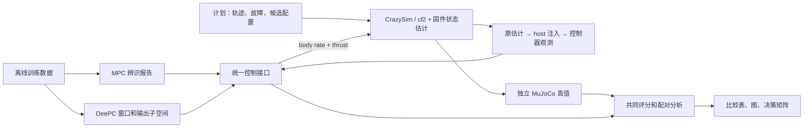

# CrazySim 巡检导航退化实验

这是 0.1–0.5 巡检比较的可执行源码入口。默认候选为 Joint FIR6（N=25）与 T6-ref（N=25、T_ini=6、ρ=.001、β=.25）。同一 HLC 生命周期、50 Hz 外环、控制预算和真值评分对所有候选生效。任务为 12 cm 缩尺直线往返。位置丢失用正常速度估计积分加横向漂移，位置偏置在主机观测上叠加有符号偏差。两者仅改变控制器的位置输入，机载估计、原状态安全门和离线真值仍走各自的路径。



| 部件 | 仓库入口 |
|---|---|
| 轨迹、位置丢失与偏置 | [inspection.py](../experiments/inspection.py) |
| 观测接线、CLI、日志和安全 | [run_flight.py](../experiments/run_flight.py) |
| 实验计划、批次和分析 | [inspection_study](../tools/inspection_study/) |
| 固定候选、评分和数据指纹 | [config](../tools/inspection_study/config/) |
| 单趟进程管理、真值和评分 | [run_crazysim_batch.py](../tools/run_crazysim_batch.py)、[crazysim_truth.py](../tools/crazysim_truth.py)、[analyze_inspection_mvp.py](../tools/analyze_inspection_mvp.py) |

可先独立替换 MPC 的 `--mpc-model`（如 `hybrid`）或 DeePC 的 `--mpc-config`（如 rank 或正则化配置）。比较 MPC 训练数据时需重新辨识并用 `--model-evidence` 指向新报告。DeePC 更换训练数据时需遵守 manifest、采样周期和推力锚点检查。新候选还需扩展分析器的固定候选 ID 和配置核验；现有巡检评分结果仅对应原候选。ML 残差或 warm start 尚未接入。

## 复现

从仓库根目录运行。需要 Python 虚拟环境、CrazySim 的依赖与已构建 cf2 SITL、可用的 25550／25450 端口，以及以下本地数据。

- DeePC 使用 `log/phase3-v1/manifest.json` 与清单中的 11 个 train NPZ。
- Joint FIR6 使用 `log/phase3-offline-coordinates/results.json`。
- 这些文件在 `log/` 内由 Git 忽略。从现有研究工作树或备份获取后保留相对路径，并以签入的 SHA-256 清单校验。批次与分析输出目录须是新目录。

```bash
export OPENBLAS_NUM_THREADS=1 OMP_NUM_THREADS=1
sha256sum -c tools/inspection_study/config/fixed-inputs.sha256

run_dir=$(mktemp -d log/inspection-replay-XXXXXX)
.venv/bin/python -m tools.inspection_study.make_plan 0.5 "$run_dir/plan.json"
.venv/bin/python -m tools.inspection_study.run_iteration \
    "$run_dir/plan.json" "$run_dir/runs" --sim-root /home/chris/CrazySim
.venv/bin/python -m tools.inspection_study.analyze_iteration "$run_dir/runs" "$run_dir/analysis"
.venv/bin/python -m tools.inspection_study.condition_contrasts "$run_dir/analysis"
.venv/bin/python -m tools.inspection_study.score_attribution "$run_dir/analysis"
.venv/bin/python -m tools.inspection_study.edge_diagnostics \
    "$run_dir/runs" "$run_dir/analysis/edge-diagnostics.csv"
```

计划器支持 0.1–0.5 共五版（6、24、32、32、12 趟）。0.1 复跑沿用同样六个条件，使用现行交替次序；历史 0.1 是两控制器分批运行。0.5 默认 +50 mm 偏置、两种时机。运行器拒绝已有输出目录，检查是否存在活跃仿真，原样保留任务失格和局部日志。`consolidate` 可组合原布局下的分版本分析，接受 `--mvp-analysis` 指定不同 MVP 目录。

## 证据索引

历史 **报告、图、派生表与原始运行** 保留在原工作树的 Git 忽略目录：

| 相对目录 | 内容 |
|---|---|
| `log/inspection-mvp-hkd41J/` | 0.1 原始六趟及初始矩阵 |
| `log/inspection-research-9Cful1/` | 0.2–0.5 原始 100 趟、计划与分版本分析 |
| `log/2026-11-28-autonomous-research-01-mpc-vs-deepc-navigation-degradation/` | 106 趟审查索引、详细架构、技术演讲证据与归档清单 |

这三个路径供本地或备份定位，仓库源码和配置不依赖这些历史报告目录。重新分析既有批次仅需该批次输入、日志及新分析目录。
