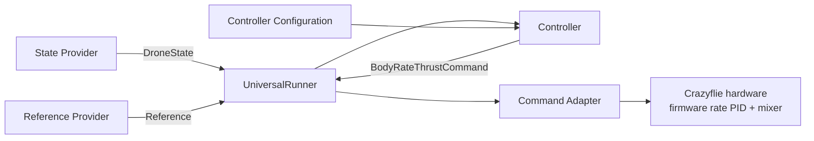

# Crazyflie Drone Control Framework

This repository is a modular Crazyflie UAV control framework for robotics and
data-driven control research. It separates state acquisition, reference
trajectories, controller mathematics, command conversion, and experiment
execution so that controllers such as the current cascaded PID can eventually
be compared with research controllers such as MPC or DeePC. The Crazyflie
firmware retains the inner body-rate PID and motor mixer; this project sends
body-rate and normalized-thrust commands.

## Architecture

The central design is **Controller + Configuration + Reference**, executed by
`UniversalRunner`:



`UniversalRunner` owns the timing and lifecycle. The state provider supplies a
unified `DroneState`; a reference provider supplies desired position, velocity,
and heading; the controller computes a `BodyRateThrustCommand`; and the command
adapter converts it to Crazyflie units. Controllers do not open hardware
connections, and references do not depend on a controller implementation.

## Quick start

```bash
git clone git@github.com:Kl51Chris/drone-control-framework.git
cd drone-control-framework
python3 -m venv .venv
source .venv/bin/activate
python -m pip install --upgrade pip
python -m pip install -r requirements-ubuntu-lock.txt  # Ubuntu/Linux
python -m experiments.run_flight \
  --controller outer-loop-pid \
  --configuration stage5-hardware-candidate \
  --reference fixed-hover
python -m pytest velocity_control_framework/tests calibration/tests
```

On WSL, use `requirements-wsl-lock.txt` instead. The inspection command does
not connect to a Crazyflie or simulate plant physics; it resolves and prints
the selected software configuration. Hardware execution requires the explicit
`--execute` switch and supervision.

## Documentation

- [Getting started](doc/getting-started.md): environment setup, inspection,
  supervised demo, tests, and troubleshooting.
- [Control design](doc/control-design.md): interfaces, equations, signs, and
  extension points.
- [Calibration toolkit](calibration/README.md): independent identification,
  replay, and hardware-validation records.
- [Architecture details](doc/architecture.md): framework boundaries and
  runner responsibilities.

## Current status

- The configurable cascaded PID is implemented in calibration and migrated to
  the production `OuterLoopPIDController`.
- A production fixed-hover experiment has connected, armed, run the control
  loop at approximately 50 Hz, and executed takeoff/hover/descent references.
  The October 26, 2026 result ended as `LANDING_FAILED`; estimator-based
  landing criteria were not met. The final recorded values were approximately
  0.1227 m height above initialized ground, 0.0031 m/s vertical velocity, and
  0.4175 normalized thrust. It is not proof of robust or unattended flight.
- The circular reference provider is available for software inspection, but
  powered circular tracking remains interlocked pending validation.
- PID gains and landing behavior remain experimental. MPC and DeePC are future
  research directions; no implementations are present in the active
  controller package.

## Tests

Use the virtual environment and run:

```bash
python -m pytest velocity_control_framework/tests calibration/tests
```

The repository also contains ROS/MuJoCo-related material; broader test
collection can require those external assets and is not required for the
controller/calibration suites above.
