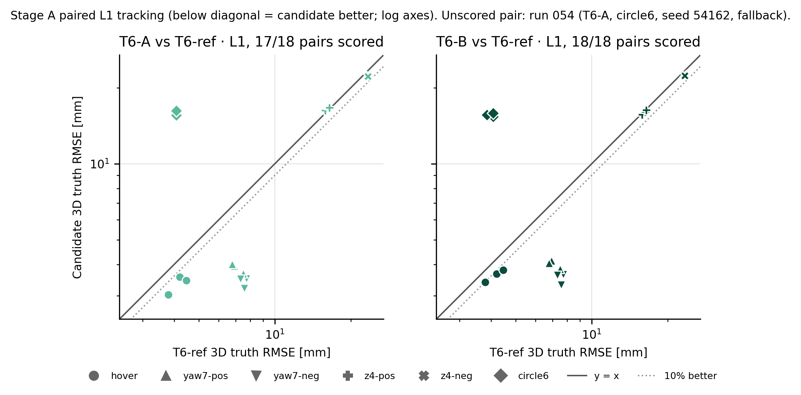
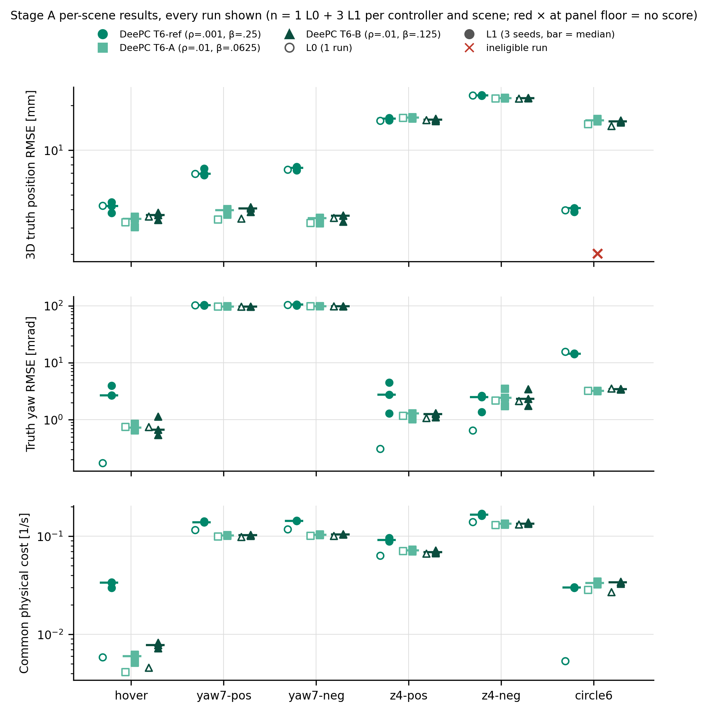
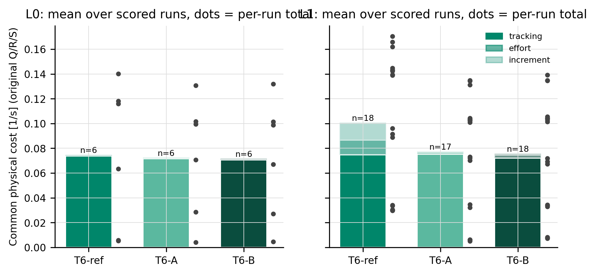
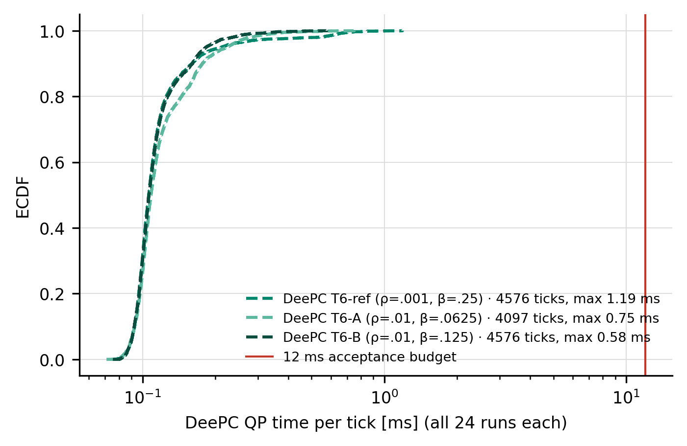
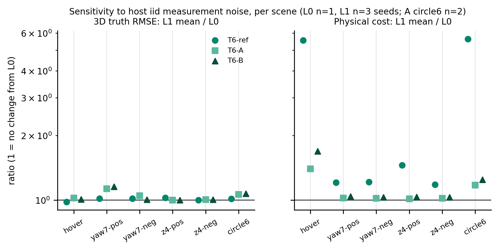
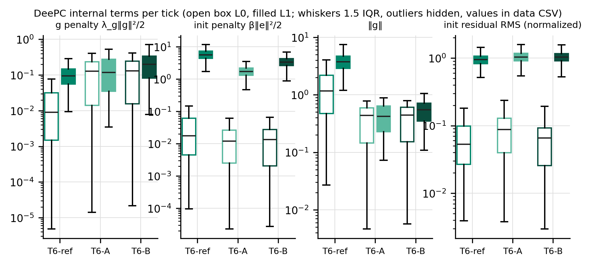
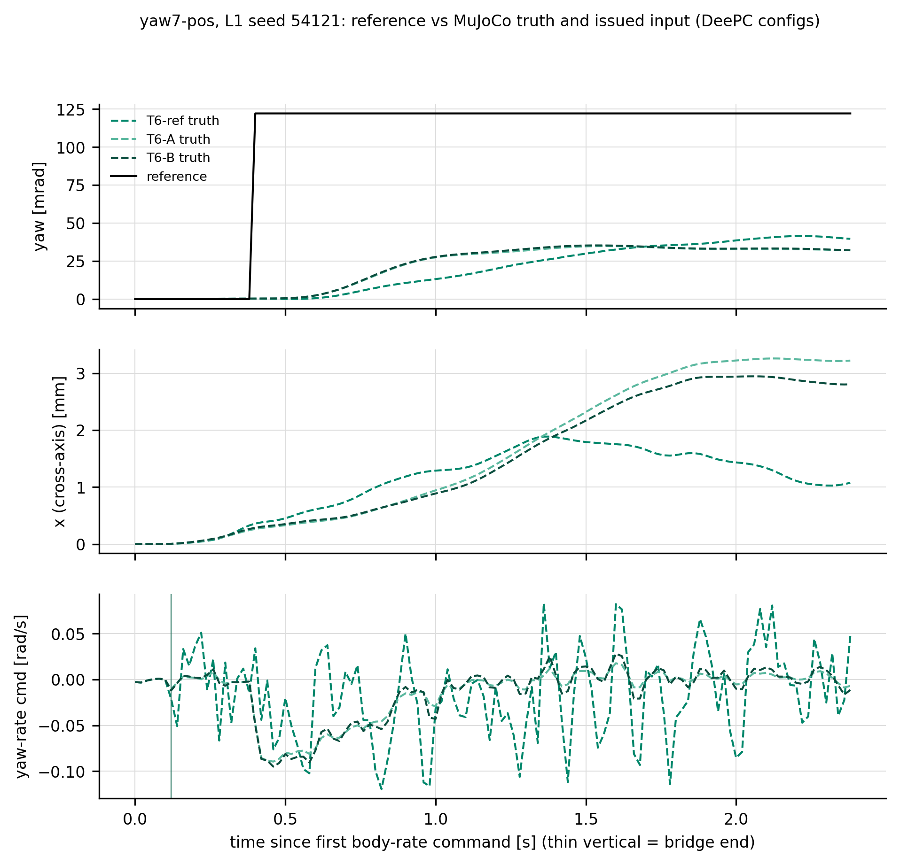
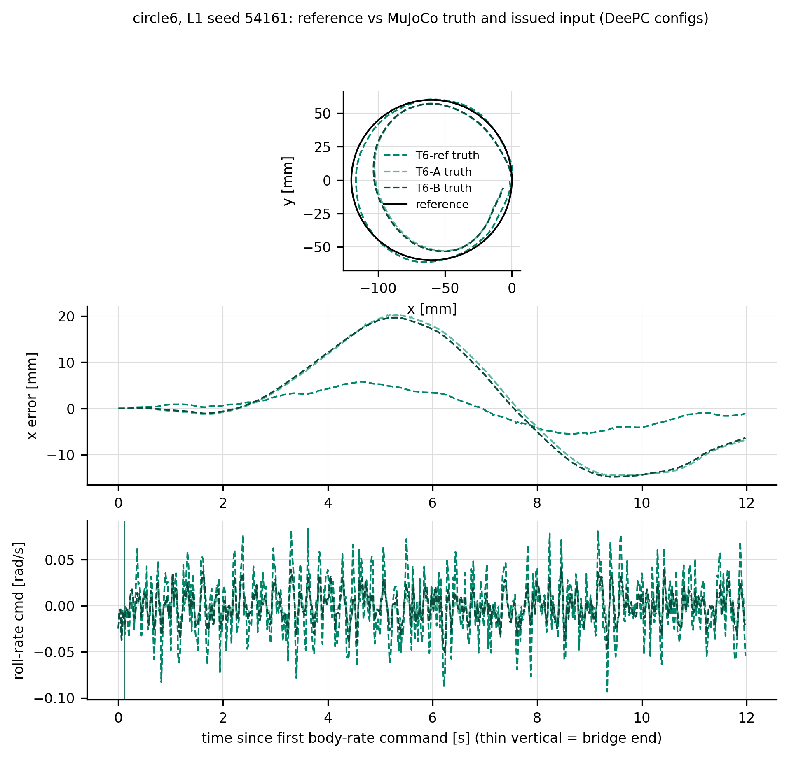

# Phase 5.4 Stage A · DeePC 正则化闭环候选筛选

执行日期 2026-11-27（America/Chicago）。预登记 [plan.md](../plan.md)，commit `506b64a`，早于任何 Phase 5.4 飞行。本报告只覆盖 Stage A。Stage B 已登记，未执行。没有冻结参数。

## 1. Executive summary

1. **本轮做了什么。** 预登记的 72 次 CrazySim SITL 闭环运行全部执行。比较三种 DeePC T6 配置：T6-ref（ρ=.001，β=.25）、A（ρ=.01，β=.0625）、B（ρ=.01，β=.125）。共 6 个从未参与调参的参考场景（悬停、±7° yaw、±4 cm Z、6 cm 圆）。每个场景 1 次 L0、3 个独立配对 L1 seed。
2. **主要结果。** 71/72 运行合格。按预登记门槛，**A 与 B 均未通过**，规则输出为**保留 T6-ref**。
   - A/B 在悬停和 yaw 阶跃中显著降低 L1 位置误差和输入抖动代价。
   - A/B 在 6 cm preview 圆上把位置误差从约 4 mm 放大到约 16 mm，配对比值约 3.9 倍。
   - L0 物理代价几何均值比约 1.19，超过 1.10 门槛，主要来自圆轨迹。
   - A 另有一次运行（054）因主机步进停顿触发 deadline miss 和 DeePC 历史连续性回退。即使不计这次失败，A 仍因 G2c 和 G5 不通过。
3. **得到支持的假设。** Phase 5.3.1 关于降低噪声敏感性的结论在闭环代价上成立：A/B 的 L1 increment 代价比 T6-ref 低约 92–96%，L1/L0 代价比在多数场景接近 1。A/B 在悬停和 yaw 阶跃上的位置优势在 L0 已存在，因此不是噪声抑制造成的。离线 CV 未覆盖的闭环代价（preview 圆跟踪退化）在本轮出现。
4. **仍未解决。**
   - 三种 DeePC 配置在 ±7° yaw 阶跃中都只到达约 30% 目标。评分窗末端的有符号 yaw 误差约 ±88 mrad。该问题与候选无关，但影响 Stage B 的 MPC/DeePC 比较。
   - 054 的主机停顿根因未确定。
   - 持续活跃约束未被激活，软约束激活 tick 数为 0。
5. **需要你批准的决定。** 见第 7 节：(a) 是否接受规则输出，以 T6-ref 进入 Stage B；(b) 是否批准 Stage B（104 次）；(c) Stage B 前如何处理机器上另一个 SITL 进程。

## 2. Experimental configuration

| 项目 | 值 |
|---|---|
| 固定条件 | phase3-v1 train-only Hankel，N25，50 Hz，12 ms 预算，原 Q/R/S，原物理和安全限制，HLC 生命周期，preview 圆，阶跃无预告 |
| 控制器 | T6-ref ρ=.001 β=.25（λ_g=.0133075）· A ρ=.01 β=.0625（λ_g=1.33075）· B ρ=.01 β=.125（λ_g=1.33075）。λ_g 预检相对误差 2e-10 |
| 场景 | hover · yaw ±0.122173 rad · z ±0.04 m（hold 2 s）· circle r=0.06 m 12 s preview |
| 噪声 | L0 amplitude 0（seed 54100 仅作标签）；L1 iid-small amplitude 1，seed 54111…54163，每块三控制器共享 |
| 评分 | `log/phase53/phase51_score.py` 原样调用；窗口 hover 75 / step 90 / circle 560 tick；真值评分 |
| 合格条件 | 完整评分窗、无 fallback、**无 runner deadline miss**、无硬输入/真值包络违规、无 QP>12 ms |
| 近零分母 | F_P=0.5 mm，F_yaw=1 mrad，F_C=1e-3 s⁻¹。本轮所有配对的 T6-ref 值均高于地板，近零规则未触发 |
| 预检 | Git `c41c715` 干净（除 CLAUDE.md）；verify_archive 310/40/494 通过；pytest 429 passed；6 场景 inspection 解析通过 |

## 3. Key visualizations

### A1 · 配对 L1 跟踪



[SVG](A1_paired_L1_tracking.svg) · [data](A1_paired_L1_tracking.csv) · [script](../analyze_stage_a.py)

- **Observation**
  - A 的 17 个有效配对、B 的 18 个配对中，大多数点落在对角线下方。
  - 例外是三个圆轨迹 seed：两候选都约 15.6–16.2 mm，T6-ref 约 3.8–4.1 mm，在图右上方偏离。
  - G2a 几何均值比 A .880（通过 ≤.90），B .975（未通过）。
- **Interpretation** 正则化改善集中在噪声主导或低速场景。圆轨迹的大比值把 B 的整体几何均值推过门槛。
- **Limitation** 每场景只有 3 个 seed，配对是开发选择，不代表统计显著性。

### A2 · 逐场景逐次结果



[SVG](A2_per_scene_runs.svg) · [data](A2_per_scene_runs.csv)

- **Observation**
  - 悬停：A/B 的 L1 位置误差为 3.35/3.62 mm，T6-ref 为 4.15 mm。
  - yaw 阶跃：A/B 约 3.4–4.0 mm，T6-ref 约 7.1–7.6 mm。
  - Z 阶跃：三者接近（16–23 mm）。G2c 中 A 的 z4-pos 比值 1.020，未达到 ≤1.0。
  - 圆：A/B 约 15.6–15.9 mm，T6-ref 4.0 mm。圆轨迹 yaw RMSE 反向，A/B 为 3.2–3.4 mrad，T6-ref 为 14.4 mrad。
  - 红 × 是 054（A，circle6，seed 54162），没有评分值。
- **Interpretation**
  - 位置误差在 Z 阶跃中由阶跃瞬态主导，三配置差别小。
  - 悬停和 yaw 阶跃中 A/B 的位置优势在 L0 同样出现（见 A5），因此是名义闭环行为差异，不是噪声抑制。在需要持续侧向运动的圆上，A/B 响应不足。
- **Limitation** yaw 阶跃的 yaw RMSE 约 100 mrad，主要来自三配置共有的 yaw 不收敛（见 A7），不能用来区分候选。

### A3 · 物理代价分解



[SVG](A3_physical_cost_decomposition.svg) · [data](A3_physical_cost_decomposition.csv)

- **Observation**
  - L1 场景均值，tracking / effort / increment 三项：T6-ref .0748 / .0119 / .0141，A .0752 / .0016 / .0006，B .0722 / .0023 / .0012（1/s）。
  - L0 下三者总代价接近（.072–.075），但圆轨迹 A/B 的 L0 代价为 T6-ref 的 5.3/5.0 倍，使 G5 代价几何均值比为 1.19。
- **Interpretation** 强正则基本消除噪声驱动的输入抖动。L1 场景均值总代价下降 23–25%，配对几何均值比为 .613/.667。tracking 项没有同步改善。
- **Limitation** 代价权重沿用原始共同 Q/R/S，结论限于该评价权重。

### A4 · 求解时间



[SVG](A4_solver_timing_ecdf.svg) · [data](A4_solver_timing_ecdf.csv)

- **Observation**
  - DeePC 主动 tick：T6-ref 4,576 个、A 4,097 个、B 4,576 个。
  - P99 分别为 .63 / .33 / .28 ms，最大 1.19 / .75 / .58 ms，超过 12 ms 的为 0。
  - 054 的 deadline miss 发生在 QP 仅 0.17 ms 的 tick 上，当步 runner work 达 34.4 ms。
- **Interpretation** 三配置都远低于预算。054 是求解器以外的主机侧停顿。
- **Limitation** 全部运行求解路径为 unconstrained，没有软约束激活。本图不能证明持续活跃约束下的实时性。

### A5 · 噪声档位



[SVG](A5_noise_level.svg) · [data](A5_noise_level.csv)

- **Observation**
  - 每点为同一场景 L1 三 seed 均值除以 L0 单次值。
  - 位置：三配置 L1/L0 为 .98–1.16，L1 噪声几乎不改变位置误差。最大值是 B 的 yaw7-pos（1.155）。
  - 代价：T6-ref 在悬停和圆上 L1/L0 为 5.5/5.6，其余场景 1.18–1.45；A/B 为 1.02–1.69。
- **Interpretation** 强正则主要降低噪声对输入和代价的影响，与 Phase 5.3.1 降低受扰历史敏感性的离线结论一致。位置跟踪对 L1 噪声本身不敏感。
- **Limitation**
  - L0 每场景只有 1 次，比值的分母没有重复。
  - Stage A 只有 L0/L1；L2 不在 Stage A 授权内。
  - 本图不代表 GNSS 退化。
  - 初版用跨场景池化中位数，受场景构成（A 少一次圆）影响而产生伪差异，已在报告前替换。

### A6 · DeePC 内部项



[SVG](A6_deepc_internal_terms.svg) · [data](A6_deepc_internal_terms.csv)

- **Observation**
  - L1 中位数，T6-ref / A / B：
    - ‖g‖ 为 3.75 / .42 / .55。
    - g penalty 为 .094 / .118 / .199。
    - init penalty 为 5.68 / 1.71 / 3.38。
    - 初始化残差 RMS 为 .94 / 1.04 / 1.03。
  - L0 下 init residual 为 .05–.09。
- **Interpretation**
  - 候选把 g 范数缩小约 7–9 倍，同时初始化拟合残差略升。这与 5.3.1 的离线现象相同。
  - g penalty 没有随 ‖g‖ 下降，因为 λ_g 大 100 倍。
- **Limitation** 这些量是控制器内部目标分项，不属于共同评价代价，不参与门槛。

### A7 · 时域响应





[yaw SVG](A7_timeseries_yaw7-pos.svg) · [yaw data](A7_timeseries_yaw7-pos.csv) · [circle SVG](A7_timeseries_circle6.svg) · [circle data](A7_timeseries_circle6.csv)

- **Observation**
  - yaw7-pos seed 54121：三配置的真值 yaw 都在约 30–40 mrad 处停住，目标 122 mrad。评分窗最后 25 tick 的有符号误差约 −84 到 −91 mrad。所有 24 次 yaw 运行中正向阶跃为负、负向阶跃为正，同一 seed 下三配置之间相差 <5 mrad。
  - T6-ref 的 yaw-rate 指令抖动明显，A/B 较平滑。
  - circle6：A/B 真值轨迹明显内缩。x 误差在约 5 s 时达 20 mm；T6-ref 最大约 6 mm。A/B 的 roll-rate 指令幅值也较小。
- **Interpretation**
  - yaw：三配置共同出现大的稳态 yaw 误差，说明问题不来自本轮正则化参数。**假设**是 DeePC 对 yaw 低频增益的数据表示不足，或 yaw 代价权重（Q_yaw=10）相对较低，两者都未验证。
  - circle：**假设**是 λ_g 增大 100 倍后，‖g‖ 被强烈压缩，相当于对未来输入序列施加额外隐式惩罚，从而在持续运动下欠驱动并缩圈。
- **Limitation**
  - 每场景只展示一个代表 seed，全部逐次数据在 CSV 中。
  - 显示时对齐了真值起点，评分未改动。
  - yaw-rate 指令符号与真值 yaw 变化方向相反，本报告不作解释，沿用 Phase 4.2 已核对的符号约定。

## 4. Quantitative results

### 预登记门槛

| 门槛 | 规则 | A（ρ=.01，β=.0625） | B（ρ=.01，β=.125） |
|---|---|---|---|
| G1 可行性 | 24/24 合格 | **未通过** 23/24（054） | 通过 24/24 |
| G2a L1 跟踪 | 几何均值比 ≤ .90 | 通过 .880（17 对） | **未通过** .975 |
| G2b 胜场 | ≥ 12/18 | 通过 12/18 | 通过 15/18 |
| G2c 场景 | ≥ 5/6 场景比 ≤ 1.0 | **未通过** 4/6（z4-pos 1.020，circle6 3.905） | 通过 5/6（circle6 3.914） |
| G3 L1 代价 | ≤ 1.10 | 通过 .613 | 通过 .667 |
| G4 L1 yaw | ≤ 1.10 | 通过 .576 | 通过 .555 |
| G5 L0 | P、C 各 ≤ 1.10 | **未通过** P .926，C 1.192 | **未通过** P .946，C 1.193 |
| 结果 | 全部通过 | 不通过 | 不通过 |

T6-ref 24/24 合格，因此规则可以给出建议：**没有候选通过全部门槛，保留 T6-ref**。机器可读结果见 [stage_a_gates.json](stage_a_gates.json)。

### L1 场景均值（3 seed；A 的 circle6 为 2 个有效 seed）

| 场景 | T6-ref P mm / yaw mrad / C | A | B |
|---|---|---|---|
| hover | 4.15 / 3.1 / .0325 | 3.35 / 0.7 / .0058 | 3.62 / 0.8 / .0078 |
| yaw7-pos | 7.07 / 102.8 / .1403 | 3.88 / 97.5 / .1019 | 4.01 / 97.1 / .1027 |
| yaw7-neg | 7.55 / 104.3 / .1437 | 3.41 / 98.6 / .1037 | 3.53 / 98.4 / .1047 |
| z4-pos | 16.21 / 2.9 / .0922 | 16.54 / 1.2 / .0718 | 16.03 / 1.2 / .0694 |
| z4-neg | 23.37 / 2.2 / .1660 | 22.37 / 2.6 / .1335 | 22.42 / 2.5 / .1361 |
| circle6 | 4.00 / 14.4 / .0301 | 15.90 / 3.2 / .0334 | 15.64 / 3.4 / .0337 |

72 次逐次绝对值、配对差、计时、bridge、软约束 tick 和稳态 yaw 见 [stage_a_runs.csv](stage_a_runs.csv)。逐 tick 的正则化代价、初始化代价、g norm、初始化残差和实际发送输入保存在各运行的 `ticks.json`。

## 5. Interpretation

- 强相对正则（λ_g 增大 100 倍、β 减小）在闭环中有三个效果：
  - 抑制测量噪声引起的输入抖动，降低 effort/increment 代价。
  - 在名义条件下也改变闭环响应：悬停和 yaw 阶跃的位置误差下降，L0 已可见。
  - 在 preview 圆这种需要持续、协调输入的参考上造成明显欠跟踪。
- 离线五折 CV 用记录的实际未来输入做条件预测，无法暴露第二种效果：在线时，输入本身由同一个带正则的优化决定。
- 这说明条件预测精度不能代替闭环选择，与 5.3.1 报告中的限制一致。
- 预登记门槛正是为此类权衡设置的，规则输出保留 T6-ref。
- 门槛本身不说明 A/B 在噪声主导任务中没有价值。如果后续研究需要，应作为新的、单独预登记的问题处理；本轮不扩展。

## 6. Failures and limitations

- **054 · A · circle6 · L1 seed 54162**
  - 经过：起飞和 bridge 正常。约 5.90 s 时 runner work 34.4 ms，QP 仅 0.17 ms，触发 14.7 ms deadline miss。随后观测间隔超过 DeePC 的 .04 s 连续性守卫，触发 HLC 回退降落。
  - 处理：按规则不合格、不复跑、留在分母中。
  - 原因：停顿发生在求解器以外。运行期间机器上另有一个与本会话无关的 SITL 进程（`cf2 19950`，PID 18370，约 47% CPU，已运行 8 小时以上），是可能因素，未经证实。
  - 敏感性：不计 054 时 A 仍因 G2c、G5 不通过，结论不变。
  - [原始运行](../../../log/phase54/stage-a/054)
- **执行事故 I1**：基础设施失败检测脚本误判，导致 001–003 各多飞一次重复运行，004 的重复被中断。首次尝试为登记运行，重复运行全部保留、未评分。修复后从 005 续跑，矩阵、seed、评分和门槛均未改。详见 [incidents.md](../incidents.md)。
- **未覆盖范围**：
  - 软约束激活 0 tick，持续活跃约束未验证。
  - 没有 L2、MPC、GNSS。
  - 每场景 3 个 seed，L0 每场景 1 次。
  - 只覆盖 near-hover、单机、固定初始 yaw 的 CrazySim。
- **yaw 不收敛**：三配置共有，原因未验证。没有调参授权，本轮只记录。

## 7. Recommended decision

1. **DeePC 配置**：按预登记规则，以 **T6-ref（ρ=.001，β=.25）** 作为 Stage B 的 DeePC 配置。A/B 不进入 Stage B，也不再在本阶段调整。需要你确认。
2. **Stage B**：建议按已登记矩阵执行（104 次，Joint FIR6、M0、T6-ref、T12-ref，新 seed 和新参考幅值）。需要你单独批准。
3. **主机负载**：Stage B 前建议处理 PID 18370 的 SITL 进程，以减少主机停顿风险。它不是本会话启动的，我没有动它，请你决定停止它还是保持原样并在报告中记录。
4. **DeePC yaw 不收敛**：建议在 Stage B 报告中作为限制单列。若需诊断，应另行预登记离线分析，不调参。
5. **参数冻结**：仍未授权，Stage B 完成并经你确认后再进行。

## 8. Reproducibility and audit appendix

- **预登记与注册文件**：plan [plan.md](../plan.md)，matrix [registered.json](../registration/registered.json)，configs [registration/configs](../registration/configs)，SHA-256 见 [registration.sha256](../registration/registration.sha256)。
- **执行与评分记录**：
  - 原始运行在 `log/phase54/stage-a/001…072`，被 Git 忽略。
  - 逐次审计在 `log/phase54/stage-a/summary.json`。
  - 批处理日志在 `log/phase54/stage-a.out`；事故前日志在 `log/phase54/stage-a-attempt1.out`。
  - 尝试清单见 [stage_a_attempts.json](stage_a_attempts.json)。
- **执行与分配**：72/72 登记运行已执行，71 合格，0 次基础设施复跑。另有事故 I1 的 4 个未评分重复目录 `001-retry1…004-retry1`。
- **环境**：Python 3.10.12，NumPy 2.2.6，SciPy 1.15.3，OSQP 1.0.4；CrazySim CF2X T350，1 ms physics，端口 26540。
- **代码变更**：只新增 `research_evidence/phase54/` 脚本和文档。生产代码、评分器、测试和阈值均未修改，测试数 429 不变。
- **复现命令**（从仓库根目录运行，使用新目录和空闲端口）：

```
export OPENBLAS_NUM_THREADS=1 PYTHONPATH=. PYTHONDONTWRITEBYTECODE=1
.venv/bin/python research_evidence/phase54/phase54.py register log/phase54-replay
.venv/bin/python research_evidence/phase54/phase54.py lambdas log/phase54-replay
.venv/bin/python research_evidence/phase54/phase54.py stage-a log/phase54-replay log/phase54-replay/stage-a --port 26640
.venv/bin/python research_evidence/phase54/analyze_stage_a.py log/phase54/stage-a research_evidence/phase54/stage-a
.venv/bin/python research_evidence/phase54/build_html.py research_evidence/phase54/stage-a/report.md research_evidence/phase54/stage-a/report.html
```
